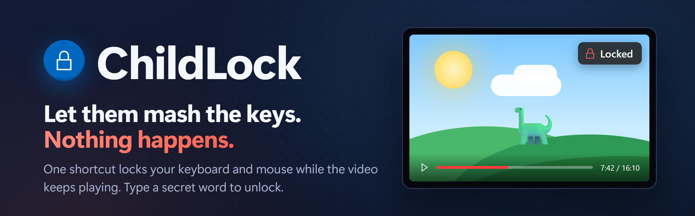
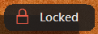
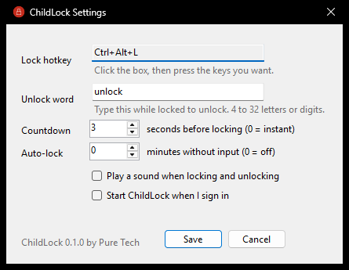
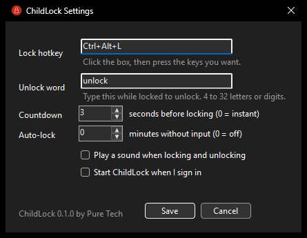

<p align="center">
  
</p>

<p align="center">
  <a href="https://github.com/puretechteam/childlock/releases/latest"></a>
  
  
  <a href="LICENSE"></a>
</p>

<p align="center">
  <b><a href="https://github.com/puretechteam/childlock/releases/latest">Download ChildLock.exe</a></b> (254 KB, no installer)
</p>

# ChildLock

Lock your keyboard and mouse with one shortcut, so a kid (or a cat) can bang on the keys and grab the mouse without anything happening. Whatever is on screen keeps playing. Type a secret word to unlock.

Made for:

- letting a kid watch a video without pausing, closing or "fixing" it
- stepping away for a minute without your open work getting wrecked
- wiping the keyboard and mouse without triggering anything

## Features

- **Locks everything:** every key, including Win, Alt+Tab, Alt+F4, Ctrl+Esc, media keys and volume keys, plus the whole mouse or touchpad (movement, clicks and scrolling). The cursor stays frozen.
- **Unlock with a secret word:** just type it while locked (default `unlock`). Random key mashing won't hit it: in a test of 1,000,000 random key presses it never unlocked.
- **Screen stays as it is:** a small "Locked" badge appears in the top-right corner and clicks pass straight through it. The PC is kept awake while locked, so a video doesn't get cut off by sleep or the screensaver.
- **Countdown before locking:** 3 seconds by default (0 to 10), so you can step back or start the video. Press Esc or the hotkey again to cancel.
- **Three ways to lock:** a hotkey (default **Ctrl+Alt+L**), **Lock now** in the tray menu, or automatically after a set number of idle minutes (off by default).
- **Always a way out:** pressing Ctrl+Alt+Del, or Windows locking (Win+L), unlocks ChildLock too.
- **Small and light:** one 254 KB exe, no installer, about 11 MB of private memory and no measurable CPU when idle.
- **Follows your Windows light or dark theme.**

## Requirements

- Windows 10 or 11 (64-bit)
- [.NET 10 Desktop Runtime](https://dotnet.microsoft.com/download/dotnet/10.0) (Windows offers to install it the first time if it's missing)

## Install

1. Download `ChildLock.exe` from the [latest release](https://github.com/puretechteam/childlock/releases/latest) and put it anywhere you like, for example `C:\Tools\ChildLock`.
2. Run it and click **Yes** at the Windows admin prompt. ChildLock needs admin rights so it can also block input aimed at admin windows such as Task Manager; without them, Windows would let keys through to those windows.
3. A padlock appears in the notification area. On Windows 11 new icons start hidden behind the **^** arrow; drag it onto the taskbar to keep it visible.
4. Optional: open **Settings** and tick **Start ChildLock when I sign in**. This creates a Task Scheduler task, so it starts with admin rights at sign-in without asking every time.

## Using it

 

| To | Do this |
|---|---|
| Lock | Press **Ctrl+Alt+L**, or right-click the padlock and choose **Lock now** |
| Cancel the countdown | Press **Esc**, or press the hotkey again |
| Unlock | Type the unlock word (default `unlock`). Nothing shows while you type, so there's nothing for a kid to react to |
| Change settings | Right-click the padlock and choose **Settings...**, or run `ChildLock.exe` again |
| Turn the hotkey off for a while | Right-click the padlock and choose **Pause hotkey** (for example while gaming). **Lock now** still works |
| Quit | Right-click the padlock and choose **Exit** |

Hover over the padlock to see the current hotkey and unlock word, in case you forget it.

### Tray menu

- **Lock now:** start the countdown and lock
- **Settings...:** hotkey, unlock word, countdown, auto-lock, sound and start at sign-in
- **Pause hotkey:** ignore the hotkey and auto-lock until you untick it (resets when ChildLock restarts)
- **Exit**

### Settings

 

| Setting | Default | Notes |
|---|---|---|
| Lock hotkey | Ctrl+Alt+L | Click the box and press the keys. Must include Ctrl, Alt or Win. If another app already uses the combination, ChildLock tells you |
| Unlock word | `unlock` | 4 to 32 letters or digits, not case-sensitive. Number-pad digits count too |
| Countdown | 3 seconds | 0 to 10. 0 locks instantly |
| Auto-lock | 0 (off) | Lock after this many minutes with no keyboard or mouse input (up to 240). Goes through the countdown like any other lock |
| Play a sound | Off | A short chime when locking and unlocking |
| Start ChildLock when I sign in | Off | Adds or removes the sign-in task. If you move the exe, ChildLock updates the task the next time it runs |

Settings are saved in `%APPDATA%\ChildLock\settings.json`. The unlock word is stored there as plain text; it's a kid-proofing word, not a password.

## What it can't block

- **Ctrl+Alt+Del.** Windows reserves this combination and no app can block it. ChildLock treats it as your way out: when the Ctrl+Alt+Del screen appears, ChildLock unlocks. A kid pressing those three exact keys together is unlikely, but possible.
- **Win+L and Windows locking.** If Windows locks, ChildLock unlocks itself. You still need your Windows password or PIN to get back in.
- **The power and sleep buttons.** Those are handled by Windows power settings, not by apps. To stop a kid turning the PC off, set the power button to "Do nothing" in Control Panel > Power Options > Choose what the power buttons do.
- **Touchpad gestures (3 and 4 finger swipes).** Normal touchpad movement, taps and scrolling are blocked. Multi-finger gestures are handled inside Windows and have not been verified yet.
- **Exclusive full-screen games.** Input is still blocked, but the badge may not show on top.

If ChildLock ever crashes, Windows removes its input hooks, so the keyboard and mouse always come back.

## Command-line options

None are needed for normal use.

| Option | What it does |
|---|---|
| `--settings <path>` | Use a different settings file. Each settings file gets its own instance |
| `--diag` | Write a diagnostics log (`diag.log`, next to the settings file) with lock events and input-hook timing |
| `--theme light\|dark\|system` | Force the settings window theme instead of following Windows |

## Uninstall

1. In Settings, untick **Start ChildLock when I sign in** (or run `schtasks /Delete /TN "PureTech\ChildLock" /F` as admin).
2. Exit ChildLock and delete `ChildLock.exe`.
3. Delete `%APPDATA%\ChildLock` to remove your settings.

## Building from source

Needs the .NET 10 SDK.

```powershell
dotnet build ChildLock.slnx
dotnet test ChildLock.slnx
dotnet publish src/ChildLock -c Release -o publish
```

Debug builds run as the normal user, so development needs no admin prompt. Release builds ask for admin rights. Override either way with `-p:ChildLockElevate=true` or `false`.

The test suite includes integration tests that start the real `ChildLock.exe` and lock this PC's keyboard and mouse for a few seconds at a time, using synthesized input. They prove that nothing leaks through while locked. Skip them with:

```powershell
dotnet test ChildLock.slnx --filter Category!=Integration
```

## License

MIT, see [LICENSE](LICENSE). Made by Pure Tech.
