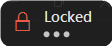

<p align="center">
  
</p>

<p align="center">
  <a href="https://github.com/puretechteam/childlock/releases/latest"></a>
  
  
  <a href="LICENSE"></a>
  <a href="https://github.com/puretechteam/childlock/actions/workflows/ci.yml"></a>
</p>

<p align="center">
  <b><a href="https://github.com/puretechteam/childlock/releases/latest">Download ChildLock.exe</a></b> (about 390 KB, no installer)
</p>

# ChildLock

Lock your keyboard and mouse with one shortcut, so a kid (or a cat) can bang on the keys and grab the mouse without anything happening. Whatever is on screen keeps playing. Type a secret word to unlock.

Made for:

- letting a kid watch a video without pausing, closing or "fixing" it
- stepping away for a minute without your open work getting wrecked
- wiping the keyboard and mouse without triggering anything

## Features

- **Locks everything:** every key, including Win, Alt+Tab, Alt+F4, Ctrl+Esc, media keys and volume keys, plus the whole mouse or touchpad (movement, clicks and scrolling). The cursor stays frozen.
- **Or just half of it:** lock only the keyboard (let them click around a game) or only the mouse (so a video can't be paused by a stray click while you type).
- **Unlock with a secret word or phrase:** just type it while locked (default `unlock`, but pick your own). Spaces are allowed, so `purple giraffe` works. Random key mashing won't hit a decent word: in a test of 1,000,000 random key presses `unlock` never unlocked.
- **Or hold the hotkey:** hold the lock hotkey (Ctrl+Alt+L) for 3 seconds to unlock, without typing anything.
- **Cleaning mode:** every screen goes black so smudges and dust show up, and the keyboard and mouse are locked while you wipe them. It ends by itself after a minute, or when you unlock.
- **Screen stays as it is:** a small "Locked" badge appears in the top-right corner of every monitor and clicks pass straight through it (or hide it completely). The PC is kept awake while locked, so a video doesn't get cut off by sleep or the screensaver.
- **Countdown before locking:** 3 seconds by default (0 to 10), so you can step back or start the video. Press Esc or the hotkey again to cancel.
- **Three ways to lock:** a hotkey (default **Ctrl+Alt+L**), the tray menu, or automatically after a set number of idle minutes (off by default).
- **Always a way out:** pressing Ctrl+Alt+Del, or Windows locking (Win+L), unlocks ChildLock too.
- **Keep older kids out of Settings:** optionally ask for the unlock word before Settings, pausing or exiting.
- **Small and light:** one exe of about 390 KB, no installer, and no measurable CPU when idle.
- **Follows your Windows light or dark theme**, tray menu included.

## Requirements

- Windows 10 or 11 (64-bit)
- [.NET 10 Desktop Runtime](https://dotnet.microsoft.com/download/dotnet/10.0) (Windows offers to install it the first time if it's missing)

## Install

1. Download `ChildLock.exe` from the [latest release](https://github.com/puretechteam/childlock/releases/latest) and put it anywhere you like, for example `C:\Tools\ChildLock`.
2. Run it and click **Yes** at the Windows admin prompt. With admin rights ChildLock can also block input aimed at admin windows such as Task Manager; without them, Windows would let keys through to those windows. If you click **No**, ChildLock still runs (and stops asking); you can turn admin rights back on in Settings.
3. A padlock appears in the notification area. On Windows 11 new icons start hidden behind the **^** arrow; drag it onto the taskbar to keep it visible.
4. Optional: open **Settings** and tick **Start ChildLock when I sign in**. With admin rights this creates a Task Scheduler task, so it starts with admin rights at sign-in without asking every time. Without admin rights it uses the normal per-user startup entry instead.

ChildLock shows its notifications as Windows toasts, some with buttons such as **Open Settings**. For Windows to show them under ChildLock's name, it adds a "ChildLock" shortcut to your Start menu the first time it shows one. `ChildLock.exe --uninstall` removes it again.

## Using it

    

The badge counts down, then shows what's locked. The dots for each correct character of the unlock word are optional.

| To | Do this |
|---|---|
| Lock | Press **Ctrl+Alt+L**, or right-click the padlock and choose **Lock now** |
| Lock only the keyboard or only the mouse | Right-click the padlock and choose **Lock only**, or make it the default in Settings |
| Clean the screen and keyboard | Right-click the padlock and choose **Cleaning mode** |
| Cancel the countdown | Press **Esc**, or press the hotkey again |
| Unlock | Type the unlock word (default `unlock`), or hold the lock hotkey for 3 seconds. Nothing shows while you type unless you turn on typing dots, so there's nothing for a kid to react to |
| Unlock a mouse-only lock | Press the lock hotkey again (the keyboard still works, so typing the word would also type it into your app) |
| Change settings | Right-click the padlock and choose **Settings...**, or run `ChildLock.exe` again |
| Turn the hotkey off for a while | Right-click the padlock and choose **Pause hotkey** (for example while gaming). **Lock now** still works |
| Quit | Right-click the padlock and choose **Exit** |

Hover over the padlock to see the current hotkey and unlock word, in case you forget it. You can hide the word from the tooltip in Settings.

### Tray menu

- **Lock now:** start the countdown and lock (the keyboard and mouse, unless you picked another default)
- **Lock only:** lock the keyboard and mouse, just the keyboard, or just the mouse
- **Cleaning mode:** black out every screen and lock everything while you wipe them
- **Settings...**
- **Pause hotkey:** ignore the hotkey and auto-lock until you untick it (resets when ChildLock restarts)
- **Exit**

While locked, the menu only shows that ChildLock is locked; nothing in it can be clicked.

### Settings

<p>
  
  
</p>

| Setting | Default | Notes |
|---|---|---|
| **Locking** | | |
| Lock hotkey | Ctrl+Alt+L | Click the box and press the keys. Must include Ctrl, Alt or Win. If another app already uses the combination, ChildLock tells you |
| Lock | Keyboard and mouse | What the hotkey, **Lock now** and auto-lock lock: keyboard and mouse, keyboard only, or mouse only |
| Countdown | 3 seconds | 0 to 10. 0 locks instantly |
| Auto-lock | 0 (off) | Lock after this many minutes with no keyboard or mouse input (up to 240). Goes through the countdown like any other lock |
| **Unlocking** | | |
| Unlock word | `unlock` | Up to 64 letters, digits and spaces, not case-sensitive. Number-pad digits count too. Short, common or sequential words (`abc`, `1234`, `password`) are allowed, but Settings warns you that they are easy to hit or guess |
| Hold to unlock | 3 seconds | Hold the lock hotkey this long to unlock (2 to 10, 0 turns it off). Only the exact hotkey counts, and pressing any other key while holding starts over |
| Show a dot for each correct character | Off | Small dots on the badge while you type the word, so you can see it's being picked up |
| Show the unlock word in the tray tooltip | On | Turn off if an older kid could read it |
| Ask for the unlock word to open Settings, pause or exit | Off | Stops someone who doesn't know the word from turning ChildLock off from the tray |
| **Badge and sound** | | |
| Show the "Locked" badge | On | The countdown badge always shows, so you can still cancel |
| Play a sound | Off | A short chime when locking and unlocking |
| **Cleaning mode** | | |
| Ends after | 60 seconds | 0 to 600. 0 keeps the screens black until you unlock. The screens fade back in over the last few seconds |
| **Startup** | | |
| Start ChildLock when I sign in | Off | Adds or removes the sign-in entry. If you move the exe, ChildLock updates it the next time it runs |
| Run as administrator | On | Ask for admin rights at start, so admin windows are locked too. Declining the prompt turns this off |

Settings are saved in `%APPDATA%\ChildLock\settings.json`. The unlock word is stored there as plain text; it's a kid-proofing word, not a password.

## What it can't block

- **Ctrl+Alt+Del.** Windows reserves this combination and no app can block it. ChildLock treats it as your way out: when the Ctrl+Alt+Del screen appears, ChildLock unlocks. A kid pressing those three exact keys together is unlikely, but possible.
- **Win+L and Windows locking.** If Windows locks, ChildLock unlocks itself. You still need your Windows password or PIN to get back in.
- **The power and sleep buttons.** Those are handled by Windows power settings, not by apps. To stop a kid turning the PC off, set the power button to "Do nothing" in Control Panel > Power Options > Choose what the power buttons do.
- **Touchpad gestures (3 and 4 finger swipes).** Normal touchpad movement, taps and scrolling are blocked. Multi-finger gestures are handled inside Windows and have not been verified yet.
- **Exclusive full-screen games.** Input is still blocked, but the badge may not show on top.
- **Touchscreens and pens.** Not tested yet, and probably not fully blocked: apps that read touch input directly may still get taps.
- **Ending ChildLock from Task Manager.** Someone at an unlocked PC can always end it there. The word prompt only protects the tray menu.
- **Without admin rights**, input aimed at admin windows (Task Manager, an installer, an admin command prompt) still gets through.

If ChildLock ever crashes, Windows removes its input hooks, so the keyboard and mouse always come back.

## Command-line options

None are needed for normal use.

| Option | What it does |
|---|---|
| `--settings <path>` | Use a different settings file. Each settings file gets its own instance |
| `--diag` | Write a diagnostics log (`diag.log`, next to the settings file) with lock events and input-hook timing |
| `--theme light\|dark\|system` | Force the settings window and tray menu theme instead of following Windows |
| `--no-elevate` | Don't ask for admin rights this time |
| `--uninstall` | Remove the sign-in entry, the Start menu shortcut and toast registration, and optionally your settings. Exit ChildLock first |

## Uninstall

1. Exit ChildLock (right-click the padlock, **Exit**).
2. Run `ChildLock.exe --uninstall`. It removes the sign-in entry, the Start menu shortcut ChildLock made for its notifications and its cached icon, and asks whether to delete your settings too. (If the sign-in task was created with admin rights, removing it needs them as well; ChildLock tells you.)
3. Delete `ChildLock.exe`.

## Building from source

Needs the .NET 10 SDK. The tray icon comes from [PureTech.Tray](https://github.com/puretechteam/puretech-tray-dotnet), included as a git submodule, so clone recursively:

```powershell
git clone --recursive https://github.com/puretechteam/childlock
cd childlock
dotnet build ChildLock.slnx
dotnet test ChildLock.slnx
dotnet publish src/ChildLock -c Release -o publish
```

In an existing clone, run `git submodule update --init` first.

Debug builds run as the normal user, so development needs no admin prompt. Release builds ask for admin rights at start. Override either way with `-p:ChildLockElevate=true` or `false`.

Every push is built and unit-tested on Windows by GitHub Actions. Pushing a tag such as `v0.2.0` (matching `<Version>` in `Directory.Build.props`) publishes `ChildLock.exe` as a GitHub release with the matching CHANGELOG section as its notes.

The test suite includes integration tests that start the real `ChildLock.exe` and lock this PC's keyboard and mouse for a few seconds at a time, using synthesized input. They prove that nothing leaks through while locked. Skip them with:

```powershell
dotnet test ChildLock.slnx --filter Category!=Integration
```

## License

MIT, see [LICENSE](LICENSE). Made by Pure Tech.
